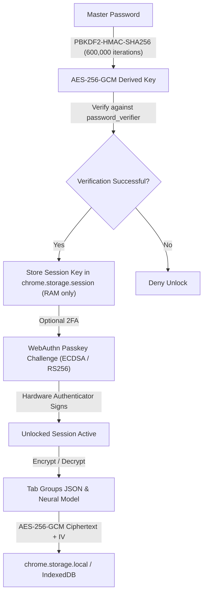

<p align="center">
  
</p>

<p align="center">
  <a href="https://github.com/Saman-ghorayshi/vault-tab/actions/workflows/test.yml"></a>
  
  
  
  
  
  
  <a href="LICENSE"></a>
</p>

<p align="center">
  <a href="https://saman-ghorayshi.github.io/vault-tab/"><strong>🧪 Launch Interactive Web Demo &raquo;</strong></a> &nbsp;&bull;&nbsp;
  <a href="docs/ARCHITECTURE.md"><strong>📖 Architecture Specification &raquo;</strong></a> &nbsp;&bull;&nbsp;
  <a href="docs/SECURITY.md"><strong>🛡️ Security Whitepaper &raquo;</strong></a> &nbsp;&bull;&nbsp;
  <a href="https://github.com/Saman-ghorayshi/vault-tab/releases/latest/download/vaulttab-v2.4.0.zip"><strong>📦 Download Extension (.zip) &raquo;</strong></a>
</p>

---

## Overview

**VaultTab** is a zero-knowledge cryptographic session and tab manager built for security researchers, Web3 developers, and privacy-conscious engineers. It safeguards sensitive tabs, active workspaces, and confidential research against physical memory dumps, shoulder-surfing, and local disk forensics.

<p align="center">
  
</p>

> [!TIP]
> **Real-World High-Stakes Workflow Shown Above:**
> 1. **Tab Clutter & Memory Hog**: 6 active research & DeFi tabs consuming 2,140 MB of RAM.
> 2. **One-Click Zero-Knowledge Stash**: VaultTab popup derives an AES-256 key via 600,000 PBKDF2 iterations and encrypts the session payload with a 128-bit MAC tag.
> 3. **Instant RAM Recovery**: Active tabs collapse into memory-free suspension, dropping browser memory usage to 24 MB (-98.8% freed).
> 4. **Spotlight Command Palette (`Ctrl+K` / `⌘K`)**: Rapid Raycast-style launcher for instant tab jumping and zero-click vault operations.
> 5. **Smart Radar Deduplication**: Automatically detects redundant tabs across all encrypted workspaces and purges duplicates with 1 click.
> 6. **Forensic Freeze-Frame Proofs**: Generates hardware-signed `.vaultproof` bundles with ECDSA P-256 and RFC 8785 canonical SHA-256 state tree digests.
> 7. **Hardware Passkey Restore**: TouchID / YubiKey FIDO2 assertion securely decrypts and restores tabs directly into native colored Chromium tab groups.

Unlike traditional tab managers that store raw URLs and unencrypted titles in plaintext LevelDB/SQLite files, VaultTab protects every record with **hardware-bound WebAuthn Passkeys (TouchID / Windows Hello / YubiKey)**, **600,000 PBKDF2-HMAC-SHA256 iterations**, and **AES-256-GCM authenticated encryption**.

---

## ⚡ Core Engineering Pillars

### 1. 🔥 Burner Workspaces & Emergency Panic Wipe
- **Time-To-Live (TTL) Sweeper**: Schedule workspaces to self-destruct after 15m, 1h, or 24h. The service worker background alarm inspects outer metadata and cryptographically shreds expired sessions with zero disk traces.
- **Burn-on-Restore**: Temporary sessions (e.g., disposable trading tabs or one-off code reviews) are permanently purged from storage the instant they are restored into browser tabs.
- **Emergency Panic Wipe (`Ctrl+Shift+X` / `Cmd+Shift+X`)**: Instantly purges all volatile cryptographic keys from `chrome.storage.session`, closes active manager views, and resets memory state.

### 2. ⚡ Serverless P2P Air-Gapped Hand-Off & QR
- **Zero-Server Workspace Transfer**: Hand off encrypted workspaces between machines or to mobile devices without database or intermediary cloud relays.
- **RFC 3986 §3.5 Air-Gap**: Payloads are Gzip-compressed, encrypted with an ephemeral 256-bit AES-GCM key, and embedded strictly into the URL hash fragment (`#share=v1.<iv>.<key>.<ciphertext>`). Fragment identifiers are never transmitted across HTTP requests to any server.
- **Embedded Vector QR**: Generates clean, zero-dependency SVG QR codes for immediate mobile camera scanning.

### 3. 🛡️ Forensic Freeze-Frame (Hardware-Signed `.vaultproof`)
- **Audit State Manifests**: Captures a snapshot of research tabs during smart contract audits or incident responses.
- **Canonical SHA-256 Digest**: Serializes state trees using RFC 8785 deterministic alphabetical key sorting.
- **Cryptographic Non-Repudiation**: The state digest is signed by the auditor's hardware passkey (FIDO2 ECDSA P-256) or ephemeral ECDSA keypair, outputting verifiable `.vaultproof` bundles.
- **Drag-and-Drop Verifier**: The live web portal provides an instant verification dropzone validating hash integrity and digital signatures.

### 4. 🎨 Chromium Tab Group Persona Swapper
- **Native Group Preservation**: Captures and persists Chromium colored tab groups (title, color, collapsed state).
- **Persona Reconstitution**: Upon restoration, native `chrome.tabGroups` APIs reconstruct the exact visual tab groups, allowing seamless switching between isolated research personas.

### 5. 🚀 Commercial Productivity & Intelligence Suite
- **Spotlight Command Palette (`Ctrl+K` / `Cmd+K`)**: Floating command launcher for rapid keyboard navigation, instant tab jumping, and one-key vault operations.
- **Vault Intelligence & Memory Dashboard**: Real-time analytics tracking estimated RAM liberated, zero-knowledge encryption status, and duplicate radar.
- **Smart One-Click Deduplication**: Automatically detects redundant URLs across all sessions and prunes duplicates while preserving session structure.
- **Multi-Format Exporter**: One-click export to GitHub-Flavored Markdown (for Obsidian/Notion), Netscape HTML Bookmarks (for browser imports), CSV spreadsheets, or raw URLs.
- **Cross-Group Tab Drag & Drop**: Seamlessly reorganize tabs across encrypted workspaces with automatic re-encryption and state persistence.

---

## ⚡ Quick Start (Install in 30 Seconds)

VaultTab runs natively on all modern Chromium browsers (**Google Chrome**, **Brave**, **Microsoft Edge**, **Arc**, **Opera**) as an unpacked Manifest V3 extension.

### Method 1: Git Clone (Recommended)
```bash
# 1. Clone the repository
git clone https://github.com/Saman-ghorayshi/vault-tab.git

# 2. Open extensions page in your browser
# Chrome: chrome://extensions
# Brave:  brave://extensions
# Edge:   edge://extensions

# 3. Toggle "Developer mode" ON in the top-right corner
# 4. Click "Load unpacked" and select the cloned folder
```

### Method 2: Packaged Release (.zip)
1. Download [vaulttab-v2.4.0.zip](https://github.com/Saman-ghorayshi/vault-tab/releases/latest/download/vaulttab-v2.4.0.zip).
2. Unzip the archive into any local folder.
3. In `chrome://extensions`, enable **Developer mode**, click **Load unpacked**, and select the unzipped directory.

---

## 🛡️ Security & Industry Benchmark

| Security Capability | VaultTab | OneTab | Session Buddy | Bitwarden / 1Password |
| :--- | :---: | :---: | :---: | :---: |
| **Encryption at Rest** | **AES-256-GCM (Authenticated)** | Plaintext LevelDB | Plaintext IndexedDB | AES-256-CBC / GCM |
| **Key Derivation** | **PBKDF2 (600,000 rounds)** | None | None | PBKDF2 / Argon2id |
| **Hardware Passkeys (FIDO2)** | **Native WebAuthn (TouchID/YubiKey)** | Unsupported | Unsupported | Supported |
| **Ephemeral RAM Isolation** | **`chrome.storage.session` (Zero Disk)** | Plaintext Disk | Plaintext Disk | RAM Process Cache |
| **Air-Gapped P2P Transfer** | **E2EE URL Hash + SVG QR** | Plaintext Export | Plaintext Export | Cloud Sync Only |
| **Forensic Audit Proofs** | **`.vaultproof` (ECDSA P-256)** | Unsupported | Unsupported | Unsupported |
| **Command Palette (`Ctrl+K`)** | **Raycast-Style Fast Launcher** | Unsupported | Unsupported | Quick Search |
| **Smart Deduplication** | **Multi-Session URL Radar** | Manual | Manual | Duplicate Alerts |
| **Markdown / Netscape Export** | **Obsidian, Notion & HTML Bookmarks** | Plaintext Only | Plaintext Only | CSV / JSON |
| **Local Vector Semantic Search** | **In-Browser Word2Vec (Quantized)** | Substring Only | Substring Only | Keyword Only |
| **Telemetry & Trackers** | **0% (100% Offline by Default)** | Analytics Trackers | Analytics Trackers | Crash Telemetry |
| **Automated Unit Testing** | **60 Passing Tests (Node 20/22/24)** | Closed Source | Closed Source | Open Source Suite |

---

## 🔬 Architecture & Cryptographic Isolation

<p align="center">
  
</p>

### Key Isolation Flow


1. **Hardware Passkeys (`common/webauthn.js`)**
   Zero-dependency implementation of WebAuthn assertion. Directly parses raw binary `authenticatorData` slices, asserts `UP` (User Present) and `UV` (User Verified) bitflags, and decodes CBOR/COSE ECDSA (curve P-256) public keys.
2. **Ephemeral Memory Life-Cycle**
   The derived AES key is never written to disk. It lives exclusively within the ephemeral `chrome.storage.session` memory space. When the auto-lock timer fires or the browser exits, the session key is immediately expunged from RAM.
3. **Chunked IndexedDB Tiering (`common/idb_storage.js`)**
   Sessions larger than 2MB are automatically split into atomic 1MB chunks and committed to IndexedDB, circumventing default extension storage quotas without memory exhaustion.
4. **On-Device Word2Vec Neural Embeddings (`common/embedder.js`)**
   A from-scratch Skip-gram neural network with negative sampling $O(k+1)$ and `int8` weight quantization. Learns local tab semantics in real time without sending queries or titles to any external LLM or cloud API.

---

## ⌨️ Productivity & Power-User Controls

### Global Browser Shortcuts (Works on Any Webpage)
- <kbd>Ctrl+Shift+S</kbd> (<kbd>Cmd+Shift+S</kbd> on macOS) — Instantly encrypts and vaults the active tab.
- <kbd>Alt+Shift+S</kbd> — Instantly encrypts and vaults all tabs in the active window.
- <kbd>Ctrl+Shift+X</kbd> (<kbd>Cmd+Shift+X</kbd> on macOS) — **Emergency Panic Wipe**: Immediately purges active encryption keys and locks vault.

### Manager Page & Spotlight Navigation
- <kbd>Ctrl+K</kbd> / <kbd>Cmd+K</kbd> — **Raycast-Style Command Palette**: Jump to any tab or trigger actions instantly.
- <kbd>J</kbd> / <kbd>K</kbd> — Vim-style down/up navigation across tab groups.
- <kbd>X</kbd> — Select focused tab and advance cursor.
- <kbd>O</kbd> / <kbd>Enter</kbd> — Open selected tab(s).
- <kbd>/</kbd> — Focus advanced search bar.
- <kbd>Esc</kbd> — Clear selection / dismiss modal dialog.
- <kbd>?</kbd> — Open keyboard shortcut cheat sheet.

### Advanced Search Operators
The search engine supports targeted filtering across your encrypted index:
- `domain:github.com` — Filters tabs matching a specific host.
- `title:"solana unstake"` — Matches exact phrase in page title.
- `-login` — Negates tabs containing "login".
- **Semantic Toggle** — Activates cosine similarity vector search over the quantized neural model.

---

## ☁️ Google Drive Encrypted Cloud Sync (Optional)

VaultTab can sync encrypted backups to your private Google Drive app-data folder (`vaulttab-cloud-backup.vaulttab`). Google never sees your tab data — only ciphertext encrypted with your client-side AES-256-GCM key.

### 5-Minute OAuth Setup:
1. Navigate to the [Google Cloud Console](https://console.cloud.google.com/) and create a project.
2. Enable the **Google Drive API** under **APIs & Services &rarr; Library**.
3. Under **OAuth consent screen**, select **External** and add your Google account as a **Test User**.
4. Under **Credentials &rarr; Create Credentials &rarr; OAuth client ID**, select **Chrome Extension** and supply your Extension ID (from `chrome://extensions`).
5. Copy the generated Client ID (`....apps.googleusercontent.com`) into `manifest.json` (`oauth2.client_id`) and reload the extension.

---

## 🧪 Automated Test Suite

VaultTab maintains an automated test suite with **60 test cases** passing across Node 20.x, 22.x, and 24.x:

```bash
npm test
```

```
✔ AUDIT: Adversarial security, injection vectors, deduplication & panics (8 tests)
✔ BURNER: TTL Expiration and Panic Purge Logic (2 tests)
✔ CRYPTO: PBKDF2 600,000 key derivation & AES-256-GCM round-trip (5 tests)
✔ DEADLOCK & CONCURRENCY: Mutex lease expiration & tab crash resilience (2 tests)
✔ EDGE CASES: Search AST, ReDoS guards & query sanitizer (4 tests)
✔ AI EMBEDDER: Web Worker training, quantization & cosine ranking (1 test)
✔ FREEZE-FRAME: Canonical RFC 8785 JSON, SHA-256 state tree & ECDSA P-256 verification (5 tests)
✔ P2P SHARE: Base64URL, Gzip stream compression, AES-GCM URL hash & vector QR (7 tests)
✔ PRODUCTIVITY: Smart URL normalization, multi-session dedup & format exports (6 tests)
✔ SECURITY AUDIT: URL scheme injection (20+ vectors), username prototype pollution & WebAuthn flag tampering (4 tests)
✔ TAB GROUPS: Color validation, native group serialization & persona reconstruction (4 tests)
✔ WEBAUTHN: ASN.1 DER to IEEE P1363 raw signature conversions (2 tests)

Total: 60 passing (0 failures, 100% green CI)
```

---

## 📄 License & Attribution

VaultTab is open-source software licensed under the **[MIT License](LICENSE)**.

Engineered with cryptographic rigor by **[Saman Ghorayshi](https://github.com/Saman-ghorayshi)**.
