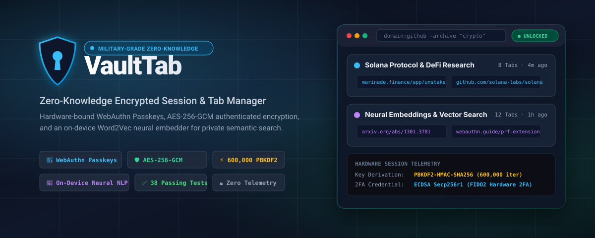
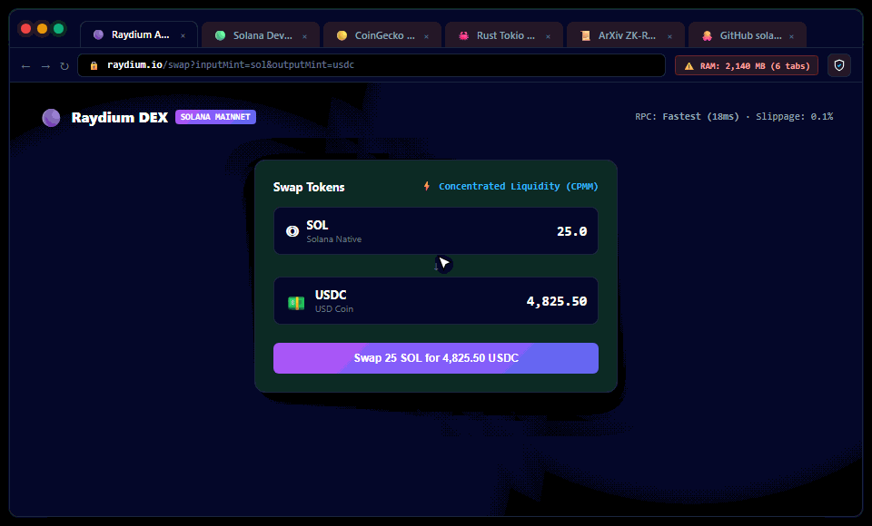
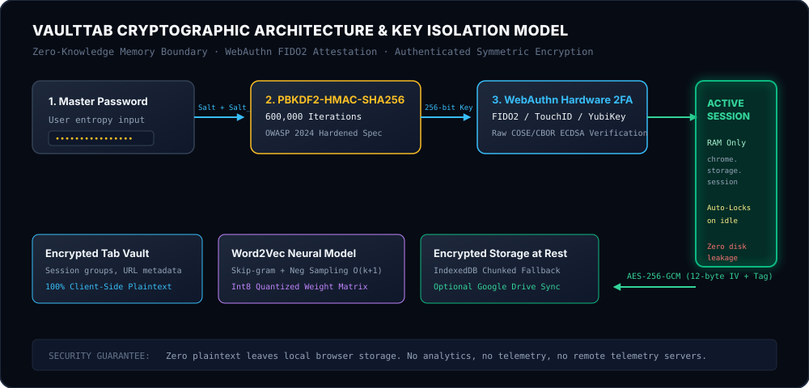
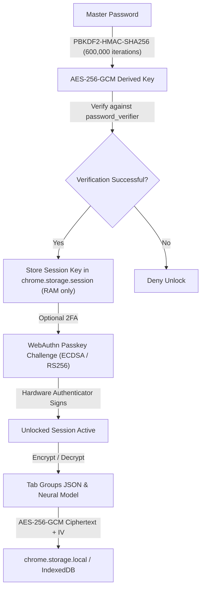

<p align="center">
  
</p>

<p align="center">
  <a href="https://github.com/Saman-ghorayshi/vault-tab/actions/workflows/test.yml"></a>
  
  
  
  
  
  
  <a href="LICENSE"></a>
</p>

<p align="center">
  <a href="https://saman-ghorayshi.github.io/vault-tab/"><strong>🧪 Launch Interactive Web Demo &raquo;</strong></a> &nbsp;&bull;&nbsp;
  <a href="docs/ARCHITECTURE.md"><strong>📖 Architecture Specification &raquo;</strong></a> &nbsp;&bull;&nbsp;
  <a href="docs/SECURITY.md"><strong>🛡️ Security Whitepaper &raquo;</strong></a> &nbsp;&bull;&nbsp;
  <a href="https://github.com/Saman-ghorayshi/vault-tab/releases/latest/download/vaulttab-v2.3.0.zip"><strong>📦 Download Extension (.zip) &raquo;</strong></a>
</p>

---

## Overview

**VaultTab** is a zero-knowledge cryptographic session and tab manager built for security researchers, Web3 developers, and privacy-conscious engineers. It safeguards sensitive tabs, active workspaces, and confidential research against physical memory dumps, shoulder-surfing, and local disk forensics.

<p align="center">
  
</p>

Unlike traditional tab managers that store raw URLs and unencrypted titles in plaintext LevelDB/SQLite files, VaultTab protects every record with **hardware-bound WebAuthn Passkeys (TouchID / Windows Hello / YubiKey)**, **600,000 PBKDF2-HMAC-SHA256 iterations**, and **AES-256-GCM authenticated encryption**.

---

## ⚡ Quick Start (Install in 30 Seconds)

VaultTab runs natively on all modern Chromium browsers (**Google Chrome**, **Brave**, **Microsoft Edge**, **Arc**, **Opera**) as an unpacked Manifest V3 extension.

### Method 1: Git Clone (Recommended)
```bash
# 1. Clone the repository
git clone https://github.com/Saman-ghorayshi/vault-tab.git

# 2. Open extensions page in your browser
# Chrome: chrome://extensions
# Brave:  brave://extensions
# Edge:   edge://extensions

# 3. Toggle "Developer mode" ON in the top-right corner
# 4. Click "Load unpacked" and select the cloned folder
```

### Method 2: Packaged Release (.zip)
1. Download [vaulttab-v2.3.0.zip](https://github.com/Saman-ghorayshi/vault-tab/releases/latest/download/vaulttab-v2.3.0.zip).
2. Unzip the archive into any local folder.
3. In `chrome://extensions`, enable **Developer mode**, click **Load unpacked**, and select the unzipped directory.

---

## 🛡️ Security & Industry Benchmark

| Security Capability | VaultTab | OneTab | Session Buddy | Bitwarden / 1Password |
| :--- | :---: | :---: | :---: | :---: |
| **Encryption at Rest** | **AES-256-GCM (Authenticated)** | Plaintext LevelDB | Plaintext IndexedDB | AES-256-CBC / GCM |
| **Key Derivation** | **PBKDF2 (600,000 rounds)** | None | None | PBKDF2 / Argon2id |
| **Hardware Passkeys (FIDO2)** | **Native WebAuthn (TouchID/YubiKey)** | Unsupported | Unsupported | Supported |
| **Ephemeral RAM Isolation** | **`chrome.storage.session` (Zero Disk)** | Plaintext Disk | Plaintext Disk | RAM Process Cache |
| **Local Vector Semantic Search** | **In-Browser Word2Vec (Quantized)** | Substring Only | Substring Only | Keyword Only |
| **Telemetry & Trackers** | **0% (100% Offline by Default)** | Analytics Trackers | Analytics Trackers | Crash Telemetry |
| **Automated Unit Testing** | **38 Passing Tests (Node 20/22/24)** | Closed Source | Closed Source | Open Source Suite |

---

## 🔬 Architecture & Cryptographic Isolation

<p align="center">
  
</p>

### Key Isolation Flow


1. **Hardware Passkeys (`common/webauthn.js`)**
   Zero-dependency implementation of WebAuthn assertion. Directly parses raw binary `authenticatorData` slices, asserts `UP` (User Present) and `UV` (User Verified) bitflags, and decodes CBOR/COSE ECDSA (curve P-256) public keys.
2. **Ephemeral Memory Life-Cycle**
   The derived AES key is never written to disk. It lives exclusively within the ephemeral `chrome.storage.session` memory space. When the auto-lock timer fires or the browser exits, the session key is immediately expunged from RAM.
3. **Chunked IndexedDB Tiering (`common/idb_storage.js`)**
   Sessions larger than 2MB are automatically split into atomic 1MB chunks and committed to IndexedDB, circumventing default extension storage quotas without memory exhaustion.
4. **On-Device Word2Vec Neural Embeddings (`common/embedder.js`)**
   A from-scratch Skip-gram neural network with negative sampling $O(k+1)$ and `int8` weight quantization. Learns local tab semantics in real time without sending queries or titles to any external LLM or cloud API.

---

## ⌨️ Productivity & Power-User Controls

### Global Browser Shortcuts (Works on Any Webpage)
- <kbd>Ctrl+Shift+S</kbd> (<kbd>Cmd+Shift+S</kbd> on macOS) — Instantly encrypts and vaults the active tab.
- <kbd>Alt+Shift+S</kbd> — Instantly encrypts and vaults all tabs in the active window.

### Manager Page Navigation
- <kbd>J</kbd> / <kbd>K</kbd> — Vim-style down/up navigation across tab groups.
- <kbd>X</kbd> — Select focused tab and advance cursor.
- <kbd>O</kbd> / <kbd>Enter</kbd> — Open selected tab(s).
- <kbd>/</kbd> — Focus advanced search bar.
- <kbd>Esc</kbd> — Clear selection / dismiss modal dialog.
- <kbd>?</kbd> — Open keyboard shortcut cheat sheet.

### Advanced Search Operators
The search engine supports targeted filtering across your encrypted index:
- `domain:github.com` — Filters tabs matching a specific host.
- `title:"solana unstake"` — Matches exact phrase in page title.
- `-login` — Negates tabs containing "login".
- **Semantic Toggle** — Activates cosine similarity vector search over the quantized neural model.

---

## ☁️ Google Drive Encrypted Cloud Sync (Optional)

VaultTab can sync encrypted backups to your private Google Drive app-data folder (`vaulttab-cloud-backup.vaulttab`). Google never sees your tab data — only ciphertext encrypted with your client-side AES-256-GCM key.

### 5-Minute OAuth Setup:
1. Navigate to the [Google Cloud Console](https://console.cloud.google.com/) and create a project.
2. Enable the **Google Drive API** under **APIs & Services &rarr; Library**.
3. Under **OAuth consent screen**, select **External** and add your Google account as a **Test User**.
4. Under **Credentials &rarr; Create Credentials &rarr; OAuth client ID**, select **Chrome Extension** and supply your Extension ID (from `chrome://extensions`).
5. Copy the generated Client ID (`....apps.googleusercontent.com`) into `manifest.json` (`oauth2.client_id`) and reload the extension.

---

## 🧪 Automated Test Suite

VaultTab maintains a comprehensive unit test suite covering cryptanalysis, vector arithmetic, and hardware parsing:

```bash
# Run all 38 automated test cases
npm test
```

```
✔ crypto.js: PBKDF2 600,000 key derivation & AES-256-GCM round-trip (11 tests)
✔ webauthn.js: COSE CBOR decoding, UP/UV flag parsing & ECDSA assertion (4 tests)
✔ embedder.js: Skip-gram negative sampling, vocab indexing & cosine similarity (12 tests)
✔ phase5: Int8 quantization precision bounds & vector clustering (11 tests)

Total: 38 passing (0 failures, 100% green CI)
```

---

## 📄 License & Attribution

VaultTab is open-source software licensed under the **[MIT License](LICENSE)**.

Engineered with cryptographic rigor by **[Saman Ghorayshi](https://github.com/Saman-ghorayshi)**.
